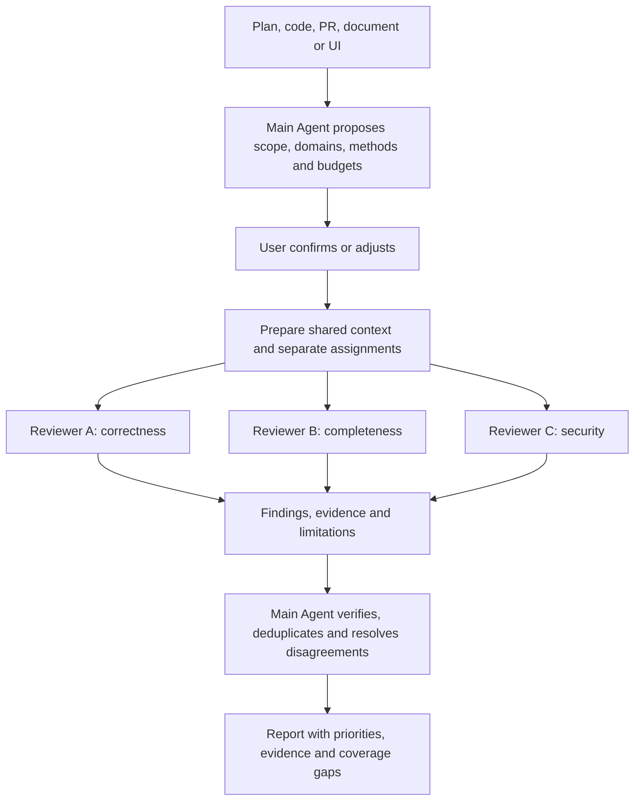

# HelpMeCheckThis

[中文](README.zh-CN.md) | **English**

**Give your Agent's work a fresh set of eyes—from more than one angle.**

HelpMeCheckThis is a Skill for vibe-coding workflows. It guides your main Agent to ask other agents to independently review plans, code, pull requests, documentation and UI work, then verify and combine their findings into an actionable report.

## Why this exists

An Agent reviewing its own work can carry the same assumptions into both creation and review. Finding one convincing issue can also anchor the rest of the inspection, leaving other kinds of problems unexplored.

Simply asking several agents to “review everything” can repeat that pattern. HelpMeCheckThis assigns explicit review domains and methods before results are shared. One reviewer might challenge the approach, another trace correctness, and another examine missing cases or security. The main Agent then checks the evidence and resolves disagreements.

This reduces reliance on a single perspective; it does not guarantee correctness. Different agents may share the same model and blind spots, so the report should state actual diversity and coverage limits.

## How it works



The three domains above are examples. The main Agent chooses multiple applicable domains for the artifact, including necessity, design reasonableness, correctness, completeness, security, maintainability, usability and documentation accuracy.

| Design choice | Why it matters |
| --- | --- |
| Multiple domains at every intensity | Quick reviews spend less effort without collapsing to one perspective. |
| Independent initial assignments | Reviewers complete their own scope before seeing others' conclusions, reducing anchoring. |
| Methods matched to the artifact | Code tracing, adversarial checks, tests, search and screenshots answer different questions. |
| Evidence followed by main-Agent verification | A confident claim or majority vote is not enough to accept a finding. |
| One Git worktree per PR reviewer | Reviewers can check out code and run experiments without sharing working files or indexes. |
| Explicit budgets and retained checkouts | Users control review effort; the main Agent keeps worktrees for follow-ups or decides when to remove them. |

Review intensity ranges from **quick** and **standard** to **deep** and **meticulous**. Reviewers may be configured CLI agents or native subagents, which can fill gaps when external agents are unavailable.

## Get started

**Requirements:** a Skill-capable host Agent and Python 3.10+. No third-party Python packages are required. External reviewers must already be configured; this Skill does not perform login and can use existing proxy or relay configurations.

Copy this repository into your host's Skill directory, preserving `SKILL.md`, `references/`, `templates/` and `scripts/`. For Claude Code, use either:

- Project installation: `<project>/.claude/skills/help-me-check-this/`
- User installation: `~/.claude/skills/help-me-check-this/`

For other hosts, register [SKILL.md](SKILL.md) through their supported Skill mechanism. In a host supporting slash invocation, run:

```text
/help-me-check-this
```

Or ask your Agent:

> Use HelpMeCheckThis to review this PR. Suggest the domains and methods, then use a deep review with a focus on correctness, missing cases and security.

On first use, the Agent helps you select available reviewers, set budgets and choose a communication directory. It proposes a review plan for confirmation before dispatch. You can also use the Skill to challenge a plan before coding or check documentation before delivery.

## Reviewers and results

- **Claude Code and Codex:** invocation adapters are included; availability depends on your installed version, permissions and provider configuration.
- **Native subagents:** dispatched through the host Agent using the same assignment and result contract.
- **pi and DeepSeek Harness (dsh):** adapters tested with DeepSeek Flash; dsh may need inline evidence when its sandbox blocks the external evidence directory. Other CLIs can use verified custom configuration.

The final report explains what was reviewed, which checks ran, which findings were accepted or remain uncertain, and what was not covered. Tests, logs and screenshots can accompany findings. Review files default to the project-local `.helpmecheckthis/` directory.

PR reviews use separate worktrees at pinned commits. Worktrees remain available for follow-up until the main Agent decides to clean them up. They share some Git metadata and are not security sandboxes. Reviews of uncommitted changes need an explicit snapshot strategy.

Skill instructions, reusable templates and structured field names are English. The main Agent delivers the final assessment and next actions in the project's working language, alongside the archived report; reviewer working languages are assigned by the main Agent. Time/token limits depend on CLI capabilities, and relay backend model identity may be unverifiable.

## Research context

[Humanize: Judgement Engineering for Agentic Coding](https://arxiv.org/html/2610.08900v2) (Liu et al.) explores independent reviewers, explicit acceptance criteria and deterministic workflow checks. Its field study documents self-assessed completion, long review tails and verification-environment problems. It provides context for this project's design; its evidence is observational and does not validate HelpMeCheckThis's multi-domain review approach.

## Learn more

| Topic | Guide |
| --- | --- |
| Agent workflow and review rules | [SKILL.md](SKILL.md) |
| Review dimensions and techniques | [Domains](references/domains.md) · [Methods](references/methods.md) · [Intensity](references/intensity.md) |
| Recommendations for different artifacts | [Artifact guides](references/artifact-guides.md) |
| Manual setup, commands and development checks | [Runner guide](references/runner-guide.md) |
| CLI invocation and permissions | [Adapters](references/adapters.md) |
| Git isolation, follow-ups and cleanup | [Worktree lifecycle](references/worktrees.md) |
| Result format and evidence handling | [Protocol](references/protocol.md) |
| Responsibilities and trust boundaries | [Architecture](references/architecture.md) |
