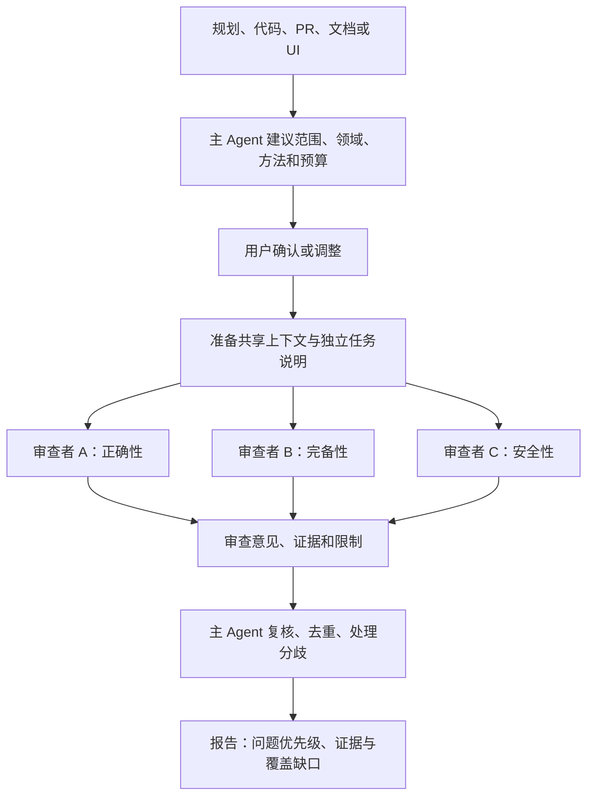

# HelpMeCheckThis

**中文** | [English](README.md)

**让其他 Agent 从不同角度，检查你的 Agent 的产出。**

HelpMeCheckThis 是面向 vibe-coding 工作流的 Skill。它指导主 Agent 邀请其他 Agent，独立审查任务规划、代码、Pull Request、文档和 UI 产出，再复核和汇总发现，给出有依据、可行动的建议。

## 为什么需要它

Agent 自己检查自己的工作时，容易沿用创作时的假设，让同一个盲区同时出现在实现和审查中。找到一个看似重要的问题后，后续检查也可能围绕它展开，遗漏其他类型的问题。

简单地让几个 Agent 都“全面检查一遍”，仍然可能重复相同的思路。HelpMeCheckThis 在共享审查结果之前，先分配明确的审查领域和方法：有人质疑方案本身，有人追踪正确性，有人检查遗漏场景或安全风险，最后由主 Agent 核验证据、处理分歧。

这种设计减少对单一视角的依赖，但不保证发现所有问题。多个 Agent 也可能使用同一模型、具有共同盲区，因此报告需要如实说明实际多样性和覆盖范围。

## 工作机制



图中的三个领域仅为示例。主 Agent 根据产物选择多个适用领域，包括必要性、方案合理性、正确性、完备性、安全性、可维护性、易用性和文档准确性等。

| 设计选择 | 解决什么问题 |
| --- | --- |
| 各档力度都覆盖多个领域 | 快速检查减少投入，但仍保留不同视角。 |
| 初轮任务独立执行 | 审查者先完成自己的范围，再看其他人的结论，减少思路被带偏。 |
| 按产物选择检查方法 | 代码追踪、对抗性检查、测试、搜索、截图分别回答不同的问题。 |
| 提交证据后再由主 Agent 复核 | 不把自信的表述或多数投票直接当成事实。 |
| PR 审查者各自使用 Git worktree | 支持 checkout 和实验，避免共享工作文件与索引造成干扰。 |
| 明确预算并保留审查工作区 | 用户控制审查投入；主 Agent 根据补充调查需要决定保留或清理。 |

检查力度分为**快速、普通、深度、吹毛求疵**四档。审查者可以是配置好的 CLI Agent，也可以是宿主的原生 subagent；外部 Agent 不足时，由 subagent 补齐。

## 开始使用

**要求：**支持 Skill 的宿主 Agent，以及 Python 3.10 或更新版本，无第三方 Python 依赖。外部审查 CLI 应已有可用配置；本 Skill 不处理登录，可沿用代理或中转站。

将本仓库复制到宿主的 Skill 目录，保留 `SKILL.md`、`references/`、`templates/` 和 `scripts/`。Claude Code 可以选择：

- 项目级安装：`<project>/.claude/skills/help-me-check-this/`
- 用户级安装：`~/.claude/skills/help-me-check-this/`

其他宿主请通过其支持的 Skill 机制注册 [SKILL.md](SKILL.md)。支持斜杠调用的宿主可以运行：

```text
/help-me-check-this
```

也可以直接告诉 Agent：

> 用 HelpMeCheckThis 审查这个 PR。先建议审查领域和方法，再进行深度检查，重点关注正确性、遗漏场景和安全性。

初次使用时，Agent 会帮助你选择可用的审查者、设置预算和交流目录，在派发前给出审查方案供确认。也可以在编码前用它质疑规划，或在交付前检查文档。

## 审查者与结果

- **Claude Code、Codex：**提供调用适配器，实际可用性取决于安装版本、权限和服务配置。
- **原生 subagent：**由宿主 Agent 派发，使用统一的任务和结果协议。
- **pi 和 DeepSeek Harness（dsh）：**适配器已通过 DeepSeek Flash 实测；dsh 沙箱无法写外部证据目录时可使用内联证据。其他 CLI 可通过核实后的自定义配置接入。

最终报告会说明审查了什么、实际执行了哪些检查、哪些问题已采纳或仍待验证，以及哪些范围尚未覆盖。发现可以附带测试结果、日志和截图。交流产物默认保存在项目的 `.helpmecheckthis/` 目录。

PR 审查使用固定提交上的独立 worktree。工作区保留到主 Agent 判断无需补充调查后，再决定清理。Worktree 仍共享部分 Git 元数据，不是安全沙箱；审查未提交改动需要明确的快照策略。

Skill 指令、复用模板和结构化字段名使用英文；主 Agent 除了保存报告，还必须用项目工作语言向用户说明最终判断和下一步行动，审查 Agent 的工作语言由主 Agent 分配。时间和 token 限制取决于 CLI 能力，中转站实际使用的后端模型也可能无法核实。

## 相关研究

[Humanize: Judgement Engineering for Agentic Coding](https://arxiv.org/html/2610.08900v2)（Liu 等）讨论了独立审查者、明确验收标准和确定性流程校验，其实地研究记录了自我验收、审查长尾和验证环境方面的问题。这为本项目的设计提供了相关参考；其证据主要是观察性的，并未验证 HelpMeCheckThis 的多领域审查方案。

## 深入了解

| 内容 | 文档 |
| --- | --- |
| Agent 工作流程与审查规则 | [SKILL.md](SKILL.md) |
| 审查维度与检查方法 | [领域](references/domains.md) · [方法](references/methods.md) · [力度](references/intensity.md) |
| 不同产物的推荐组合 | [产物指南](references/artifact-guides.md) |
| 手动配置、命令及开发验证 | [Runner 使用指南](references/runner-guide.md) |
| 各 CLI 的调用和权限 | [适配器说明](references/adapters.md) |
| Git 隔离、补充调查与清理 | [Worktree 生命周期](references/worktrees.md) |
| 结果格式与证据处理 | [通信协议](references/protocol.md) |
| 职责边界与信任模型 | [架构说明](references/architecture.md) |
